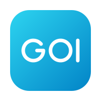

<p align="center">
  
</p>

<h1 align="center">goi</h1>

<p align="center">A declarative GUI framework for Go, rendered with WebGPU.</p>

goi describes a window in `.goi` files: elements, properties, ids, `if`/`else`
and `for` loops. Go finds elements by id, holds the
state and attaches the behaviour. Edit a `.goi` file and the window updates
without a restart: hot reload is built in.

## Counter

The design declares the values it reads and the handlers it calls in a `bridge`
block. Go supplies both.

```goi
// counter.goi

bridge {
	Count int
	onInc func()
	onDec func()
}

Window {
	title: "Counter"

	Column {
		padding:        24
		spacing:        16
		crossAxisAlign: center

		Text {
			text: formatf("%d", bridge.Count)
			role: displayLarge
		}

		Row {
			spacing: 12

			Button {
				id:      dec
				label:   "−"
				variant: outlined
				onClick: bridge.onDec()
			}

			Button {
				id:      inc
				label:   "+"
				onClick: bridge.onInc()
			}
		}
	}
}
```

```go
var count int // outside Bind: Bind runs again after every hot reload

func main() {
	app, _ := ui.NewApp()
	win, _ := app.LoadWindowFile("counter.goi", ui.WithHotReload(true))

	win.Bind(func(w *ui.Window) error {
		ui.SetData(w, "Count", count)
		if err := ui.SetHandler(w, "onInc", func() {
			count++
			ui.SetData(w, "Count", count)
		}); err != nil {
			return err
		}
		return ui.SetHandler(w, "onDec", func() {
			count--
			ui.SetData(w, "Count", count)
		})
	})

	app.Run()
}
```

`SetData` feeds `bridge.Count`; `SetHandler` supplies the body a bridge call runs.
The label follows the value without a manual repaint.

## Conditionals and loops

`if`/`else` and `for ... range` read like Go, and a list comes from the bridge:

```goi
// inbox.goi

bridge {
	Loading  bool
	Messages []Message
}

type Message {
	From    string
	Subject string
	Unread  bool
}

Window {
	title: "Inbox"

	Column {
		padding: 24
		spacing: 8

		if bridge.Loading {
			Text {
				text: "Loading…"
			}
		} else {
			for _, message := range bridge.Messages {
				ListItem {
					label:      message.From
					supporting: message.Subject
					selected:   message.Unread
				}
			}
		}
	}
}
```

```go
ui.SetData(w, "Loading", false)
ui.SetData(w, "Messages", messages) // any slice of structs
```

The rows rebuild when the list is set; a scalar such as `bridge.Loading` only
toggles what the `if` shows.

## Several files

A design can import fragments and pass them values, so a page does not have to be
one long file.

```goi
// ui/Main.goi

import Sidebar "./Sidebar.goi"

Window {
	id:    main
	title: "Mail"

	Row {
		Sidebar {
			title: "Inbox"
		}

		Column {
			flex:    1
			padding: 24

			Text {
				text: "Select a message"
				role: titleLarge
			}
		}
	}
}
```

```goi
// ui/Sidebar.goi

props {
	title string
}

Column {
	width:      280
	padding:    12
	spacing:    6
	background: surfaceContainer

	Text {
		text: props.title
		role: titleLarge
	}

	NavigationItem {
		label:    "Inbox"
		icon:     inbox
		selected: true
	}

	NavigationItem {
		label: "Starred"
		icon:  star
	}

	NavigationItem {
		label: "Sent"
		icon:  send
	}
}
```

The directory is the asset container, and hot reload watches every file the
design reads:

```go
win, _ := app.LoadWindow(ui.DirFS("ui"), "Main.goi", ui.WithHotReload(true))
```

For a single binary, pass an embedded filesystem instead:
`app.LoadWindow(assets, "ui/Main.goi")`.

## Features

- **Declarative design files.** Elements, properties, ids, `if`/`else` and
  `for ... range`; diagnostics point at `file:line:col`.
- **State and events in Go.** `bridge` declarations, `ui.SetData`,
  `ui.SetHandler`, typed `Prop[T]`, `Event[E]` and `ByID[T]`.
- **Composition.** Imports, typed `props`, named slots and `$children`, scoped
  ids, loading from any `io/fs.FS`.
- **Material 3.** Buttons, text fields, cards, dialogs, sheets, menus, navigation,
  progress and more, with light and dark schemes, Roboto and Material Symbols.
- **Layout.** Column, Row and Stack, Wrap, Grid, flex sizing, responsive
  breakpoints, padding and margin, and scrolling containers.
- **Text and media.** M3 type scale, word wrapping, bidirectional shaping, PNG,
  JPEG, GIF and SVG with theme colours.
- **Native shell.** Window chrome control, file dialogs, notifications, keyboard
  input and hot reload.
- **Language server.** `goipls` adds diagnostics (including inside imported
  fragments), completion, hover docs, document outline and go-to-definition,
  plus formatting on save.
- **Editor extension.** A [Zed extension](https://github.com/goi-gui/zed-goi)
  brings syntax highlighting, brackets, indentation, an element outline and the
  `.goi` file icon. It is the only editor extension so far; elsewhere the
  language server still works over stdio.
- **Formatter.** `goifmt` aligns fields and properties, one property per line,
  and runs through the language server or as `go run ./cmd/goifmt -w`.
- **Renderer.** Instanced WebGPU drawing below a small SDL3 platform layer,
  HiDPI aware, Wayland and X11 from one binary.

See the [documentation](https://goi-gui.github.io/docs/) for the language and
every element.

## Contributing

Contributions are welcome: open an issue or a pull request. Keep changes focused
and match the surrounding style, then run:

```sh
make test
make vet
```

## License

[MIT](LICENSE) © ksckaan1
